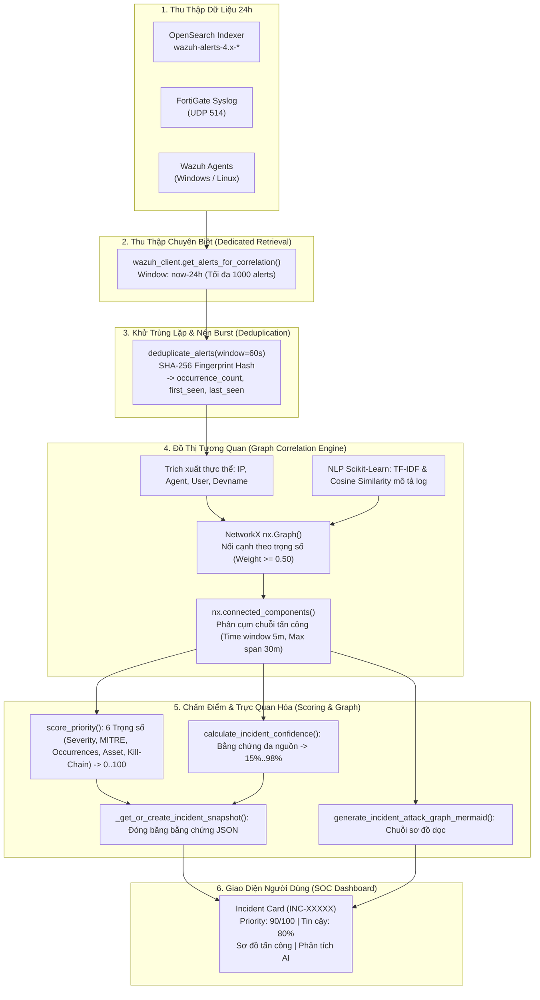

# 📚 BÁO CÁO CƠ CHẾ VẬN HÀNH & THUẬT TOÁN TƯƠNG QUAN SỰ CỐ 24H (INCIDENT CORRELATION ENGINE)

> **Tài liệu Kỹ thuật Chuẩn Kiến trúc Hệ thống AgentWazuh SOC Platform**  
> *Mã nguồn chịu trách nhiệm cốt lõi:* [`services/correlation_engine.py`](file:///home/xinloihuy/AgentWazuh/services/correlation_engine.py), [`services/wazuh_client.py`](file:///home/xinloihuy/AgentWazuh/services/wazuh_client.py), [`core/server.py`](file:///home/xinloihuy/AgentWazuh/core/server.py), [`web/app.js`](file:///home/xinloihuy/AgentWazuh/web/app.js).

---

## 1. Tổng Quan & Bài Toán Thực Tế (Why Correlation?)

Trong một trung tâm điều hành an ninh mạng (SOC), các hệ thống giám sát như **Wazuh SIEM** và **Tường lửa FortiGate** liên tục sinh ra hàng nghìn tới hàng chục nghìn dòng nhật ký (Alerts) mỗi ngày. Hiện tượng này dẫn tới **"Alert Fatigue"** (Hội chứng kiệt quệ cảnh báo):
- Các chuyên viên SOC không thể đọc từng dòng log rời rạc để phát hiện một đợt tấn công phức tạp.
- Một vụ tấn công dò mật khẩu (SSH/RDP Brute Force) có thể bắn ra **hàng nghìn alert riêng lẻ** chỉ trong vài phút.
- Một cuộc xâm nhập có chủ đích (APT) thường trải qua chuỗi nhiều giai đoạn (Reconnaissance ➔ Initial Access ➔ Privilege Escalation ➔ Lateral Movement ➔ Impact). Mỗi giai đoạn lại kích hoạt các Rule ID khác nhau trên các máy chủ khác nhau.

**Hệ thống "Nhóm sự cố tương quan 24h"** của AgentWazuh được thiết kế để tự động:
1. **Lọc rác & Nén cụm (Deduplication)**: Gom các đợt bùng nổ cảnh báo lặp lại thành một sự kiện duy nhất kèm bộ đếm tần suất.
2. **Liên kết đa chiều (Multi-Entity Correlation)**: Tương quan dựa trên thực thể chung (IP, Agent, Hostname, User), chuỗi tấn công di chuyển ngang (Lateral Movement) và ngữ nghĩa nội dung log (NLP).
3. **Mô hình hóa Đồ thị Tấn công (Graph-Based Attack Chain)**: Biến các log rời rạc thành một chuỗi Kill-Chain trực quan (Mermaid).
4. **Chấm điểm Ưu tiên & Độ tin cậy (Priority & Confidence Scoring)**: Đưa ra chỉ số từ 0 - 100 để Analyst biết sự cố nào cần xử lý khẩn cấp nhất.

---

## 2. Sơ Đồ Khái Quát Luồng Dữ Liệu (End-to-End Pipeline)



---

## 3. Chi Tiết Các Cơ Chế & Thuật Toán Cốt Lõi

### Cơ Chế 1: Thu Thập Độc Lập Với Cửa Sổ Trượt 24h (Dedicated 24h Retrieval)
- **Vị trí code**: `services/wazuh_client.py` (`get_alerts_for_correlation`)
- **Cơ chế hoạt động**:
  - Không dùng cache tạm thời của màn hình xem trước (vốn chỉ lấy 200 dòng).
  - Sử dụng hàm chuyên biệt `get_alerts_for_correlation(hours_back=24, max_results=1000)` truy vấn trực tiếp vào OpenSearch qua Elasticsearch DSL Query:
    ```json
    {
      "range": {
        "timestamp": { "gte": "now-24h", "lte": "now" }
      }
    }
    ```
  - **Auto-expand Fallback**: Nếu hệ thống phát hiện trong 24 giờ qua không có cảnh báo mới (ví dụ môi trường Lab/Offline), hệ thống tự động mở rộng cửa sổ lên **720 giờ (30 ngày)** để luôn đảm bảo có đủ dữ liệu lịch sử cho việc huấn luyện và kiểm thử tương quan.

---

### Cơ Chế 2: Khử Trùng Lặp & Nén Cụm Bùng Nổ (Burst Deduplication Engine)
- **Vị trí code**: `services/correlation_engine.py` (`deduplicate_alerts`)
- **Vấn đề giải quyết**: Một đợt Brute Force có thể bắn ra 500 alert giống hệt nhau chỉ khác mili-giây. Nếu đưa cả 500 alert vào đồ thị NetworkX, thuật toán sẽ bị quá tải ($O(N^2)$ cạnh) và sơ đồ tấn công sẽ bị rác.
- **Thuật toán Fingerprinting**:
  Mỗi alert được chuẩn hóa thành một mã băm SHA-256 duy nhất:
  $$\text{Fingerprint} = \text{SHA256}(\text{Rule ID} + \text{Agent ID} + \text{Agent Name} + \text{Src IP} + \text{Dst IP} + \text{Src Port} + \text{Dst Port} + \text{User} + \text{Process} + \text{Devname} + \text{Payload Data})$$
- **Cơ chế Cửa sổ trượt 60 giây (60-second Sliding Burst)**:
  - Sắp xếp cảnh báo tăng dần theo thời gian.
  - Nếu một cảnh báo mới có cùng `Fingerprint` với cảnh báo trước đó và khoảng cách thời gian $\Delta t \le 60\text{ giây}$:
    - Không tạo alert mới.
    - Tăng biến đếm: $\text{occurrence\_count} \leftarrow \text{occurrence\_count} + 1$.
    - Cập nhật thời điểm kết thúc $\text{last\_seen} = \text{timestamp mới}$.
    - Lưu mã ID vào danh sách mảng chứng cứ `evidence_ids`.
    - Lưu tối đa 12 mẫu payload sự kiện gốc `evidence_events` để không làm mất log thô khác biệt.

---

### Cơ Chế 3: Trích Xuất & Chuẩn Hóa Thực Thể Đa Chiều (Multi-Entity Normalization)
- **Vị trí code**: `extract_entities()` và `extract_alert_entities()` trong `services/correlation_engine.py`
- **Cơ chế**:
  Để tương quan chéo giữa máy trạm (Wazuh Agent trên Windows/Linux) và thiết bị mạng (FortiGate Firewall qua Syslog), hệ thống trích xuất các **Thực thể có kiểu (Typed Entities)**:
  - `ip:<Địa chỉ IP>`: Tự động lọc các IP rác nội bộ ảo (`0.0.0.0`, `127.0.0.1`, `255.255.255.255`, `::1`), kiểm tra tính hợp lệ qua thư viện Python `ipaddress`.
  - `agent:<Tên máy>` & `agent-id:<Mã Agent>`: Ví dụ `agent:win-01`, `agent-id:008`.
  - `user:<Tên tài khoản>`: Lấy từ `srcuser`, `dstuser`, Windows EventData (`targetUserName`, `subjectUserName`), bỏ qua tài khoản mặc định `system`, `root`, `-`.
  - `host:<Hostname>` hoặc `host:<devname>`: Tên máy tính hoặc tên thiết bị FortiGate Firewall.

---

### Cơ Chế 4: Thuật Toán Tương Quan Đồ Thị & NLP (Graph-Based Correlation & NLP Mechanics)
- **Vị trí code**: `correlate_alerts()` trong `services/correlation_engine.py`
- **Công nghệ sử dụng**:
  - **NetworkX (`nx.Graph`)**: Cấu trúc dữ liệu đồ thị vô hướng đa nút.
  - **Scikit-Learn (`TfidfVectorizer` + `cosine_similarity`)**: Mô hình hóa ngữ nghĩa văn bản log bằng học máy.

#### 4.1. Ma Trận Tương Đồng Ngữ Nghĩa NLP (TF-IDF & Cosine Similarity)
Với mỗi alert, gom chuỗi văn bản gồm: `Rule Description` + `Full Log` + `JSON Data`. Sau đó vector hóa thành ma trận TF-IDF loại bỏ stop words tiếng Anh. Tính toán độ tương đồng Cosine Similarity giữa cặp alert $i$ và $j$:
$$\text{Sim}(i, j) = \frac{\vec{V}_i \cdot \vec{V}_j}{\|\vec{V}_i\| \|\vec{V}_j\|} \in [0, 1]$$
Nếu $\text{Sim}(i, j) \ge 0.65$, hai sự kiện được xác nhận là có cùng bản chất hành vi (ví dụ cùng là nỗ lực tiêm mã injection hoặc cùng quét file).

#### 4.2. Bảng Trọng Số Nối Cạnh (Edge Weights & Reasons)
Giữa hai cảnh báo $A_1$ và $A_2$, hệ thống chỉ xét nối cạnh nếu khoảng cách thời gian $\Delta t = |t_2 - t_1| \le \text{time\_window}$ (mặc định **5 phút**). Trọng số tương quan $W \in [0.0, 1.0]$ được cộng dồn theo các điều kiện:

| Điều Kiện Tương Quan | Trọng Số Cộng Thêm | Mã Lý Do Tương Quan | Ý Nghĩa Thực Tế Trong SOC |
|---|---|---|---|
| **Trùng IP Nguồn** (`srcip`) | **+0.50** | `shared_src_ip` | Cùng một kẻ tấn công từ một địa chỉ IP bên ngoài đang thực hiện nhiều hành vi. |
| **Trùng IP Đích** (`dstip`) | **+0.40** | `shared_dst_ip` | Cùng một máy chủ mục tiêu đang phải hứng chịu các hành vi xâm nhập. |
| **Di Chuyển Ngang / Bước Nhảy (Lateral Movement Pivot)** | **+0.55** | `lateral_movement_pivot` | **Cực kỳ nguy hiểm**: IP đích của bước 1 trở thành IP nguồn của bước 2 ($dst_1 == src_2$ hoặc ngược lại). Minh chứng máy này đã bị chiếm quyền và đang tấn công tiếp máy khác! |
| **Trùng Máy Trạm (Agent/Host)** | **+0.45** | `shared_agent` | Chuỗi hành vi diễn ra liên tiếp trên cùng một máy chủ/máy trạm. |
| **Trùng Tài Khoản (User)** | **+0.40** | `shared_user` | Kẻ tấn công hoặc người dùng đang thao tác trên cùng một tài khoản tài nguyên. |
| **Trùng Thiết Bị (Devname)** | **+0.30** | `shared_device` | Sự kiện ghi nhận trên cùng một thiết bị tường lửa mạng. |
| **Tương Đồng Ngữ Nghĩa (NLP Text Similarity $\ge 0.65$)** | **+ $\text{Sim} \times 0.30$** | `semantic_similarity` | Hai dòng log có mô tả và payload kỹ thuật tương đồng cao. |
| **Chuỗi Quy Tắc Tiếp Nối (Rule Sequence / MITRE)** | **+0.15 ➔ +0.25** | `rule_sequence`, `mitre_context` | Các rule khác nhau xuất hiện trên cùng tài sản nhưng có liên kết cùng kỹ thuật MITRE ATT&CK hoặc Rule Level cao ($\ge 7$). |

#### 4.3. Hệ Số Suy Giảm Theo Thời Gian (Temporal Decay Factor)
Các sự kiện diễn ra càng xa nhau trong cửa sổ 5 phút thì mối liên kết càng giảm dần theo hàm tuyến tính:
$$\text{Decay} = \max\left(0.80,\; 1.0 - 0.20 \times \frac{\Delta t}{\text{Window}}\right)$$
$$\text{Final Weight} = \min(1.0,\; W_{\text{raw}} \times \text{Decay})$$

#### 4.4. Phân Tách Cụm Bằng Thành Phần Liên Thông (Connected Components)
1. Thêm tất cả các cạnh có `Weight >= 0.50` vào đồ thị $G$.
2. Gọi hàm `nx.connected_components(G)` của NetworkX để tìm tất cả các thành phần liên thông độc lập.
3. **Cắt phân đoạn thời gian tối đa (Max Span Segmentation)**: Nếu một cụm kéo dài liên tục vượt quá `max_incident_span_minutes` (mặc định **30 phút**), thuật toán tự động tách làm hai Incident Group khác nhau để tránh việc một nhóm kéo dài cả ngày gây mất tính cục bộ của từng đợt tấn công.
4. **Loại bỏ sự kiện đơn lẻ (Singleton Guard)**: Chỉ những nhóm sự cố có $\ge 2$ alert được liên kết hoặc có hiện tượng lặp lại cảnh báo (`repeated_activity`) mới được giữ lại. Các alert lẻ loi không liên quan ai sẽ chuyển về danh sách Tab "Alert thô".

#### 4.5. Sinh Định Danh Incident ID Tất Định (Deterministic Hash)
Mã Incident ID không được sinh ngẫu nhiên (UUID) mà sinh bằng hàm băm SHA-256 từ Thực thể chính và Alert neo đầu tiên:
$$\text{Group ID} = \text{SHA256}(\text{Primary Entity} + \text{Anchor Alert ID})[0:12]$$
$$\text{Incident ID} = \text{"INC-" } + \text{Group ID}.\text{upper()}$$
*(Ví dụ thực tế trong ảnh của bạn:* `INC-15B983379001`, `INC-D9499DBCCDAO`*)*.  
Điều này bảo đảm dù tải lại trang hay khởi động lại máy, cùng một chuỗi sự cố sẽ **luôn luôn có cùng một ID**, không bị nhảy mã.

---

### Cơ Chế 5: Thuật Toán Chấm Điểm Ưu Tiên (Priority Score) & Độ Tin Cậy (Confidence)

#### 5.1. Thuật Toán Tính Priority Score (Thang điểm 0 - 100)
- **Vị trí code**: `score_priority()` trong `services/correlation_engine.py`
Điểm số phản ánh mức độ nguy cấp thực tế của đợt tấn công để phân loại màu sắc:
- **Đỏ (Critical)**: Score $\ge 80$ (Ví dụ trong ảnh: `PRIORITY: 90/100`).
- **Cam (High)**: Score $50 - 79$ (Ví dụ trong ảnh: `PRIORITY: 67/100`).
- **Vàng (Medium)**: Score $30 - 49$ (Ví dụ trong ảnh: `PRIORITY: 49/100`, `48/100`).
- **Xanh (Low)**: Score $< 30$.

Điểm tổng được tính bằng tổng của 6 thành phần:
$$\text{Priority Score} = \min(100,\; W_1 + W_2 + W_3 + W_4 + W_5 + W_6)$$

| Thành Phần Điểm | Trọng Số Tối Đa | Công Thức Tính | Rationale / Giải Thích |
|---|---|---|---|
| **$W_1$: Mức độ nghiêm trọng tối đa (Severity)** | **45 điểm** | $\min(\text{Max Rule Level} \times 3.0,\; 45)$ | Alert có Rule Level cao nhất trong nhóm (Level 15 $\rightarrow$ 45 điểm; Level 12 $\rightarrow$ 36 điểm). |
| **$W_2$: Ma trận MITRE ATT&CK** | **15 điểm** | $\min(|\text{Techniques}| \times 4 + |\text{Tactics}| \times 2,\; 15)$ | Càng nhiều kỹ thuật MITRE được ánh xạ chứng tỏ đợt tấn công càng phức tạp. |
| **$W_3$: Tần suất bùng nổ Logarit** | **10 điểm** | $\min(\log_{10}(\max(\text{Count}, 1)) \times 6,\; 10)$ | Dùng hàm Logarit cơ số 10 để số lượng cảnh báo lớn (như 156 alert) tăng điểm một cách tự nhiên mà không làm bão hòa hệ thống. |
| **$W_4$: Mức độ nhạy cảm của tài sản (Asset Criticality)** | **10 điểm** | $\min(\text{Asset Level} \times 2,\; 10)$ | Tra cứu trong danh mục thiết bị CMDB: Máy chủ Database/DC (Critical: 5 $\rightarrow$ 10đ), Máy nhân viên (Low: 1 $\rightarrow$ 2đ). |
| **$W_5$: Độ tin cậy tương quan** | **10 điểm** | $\min(\frac{\text{Correlation Confidence}}{10},\; 10)$ | Nhóm sự cố có bằng chứng liên kết rõ ràng sẽ được ưu tiên cao hơn nhóm mơ hồ. |
| **$W_6$: Giai đoạn tấn công Kill-Chain Stage** | **10 điểm** | Max điểm giai đoạn ATT&CK | Giai đoạn càng sâu thì điểm càng cao: Trinh sát (Recon: 1đ), Thực thi (Execution: 5đ), Leo thang (Privilege Escalation: 6đ), Di chuyển ngang (Lateral Movement: 8đ), Tác động / Tống tiền (Impact / Exfiltration: 10đ). |

---

#### 5.2. Thuật Toán Tính Độ Tin Cậy (Confidence Score 15% - 98%)
- **Vị trí code**: `calculate_incident_confidence()` trong `services/correlation_engine.py`
- Hiển thị trên nhãn màu xanh lá trên card: `@ TIN CẬY: 80%`, `@ TIN CẬY: 81%`, `@ TIN CẬY: 73%`.
- **Cơ chế tính điểm**:
  1. **Quy mô cụm ($10 - 25$ điểm)**: Cụm có nhiều alert liên kết chặt chẽ sẽ tăng độ tin cậy.
  2. **Trọng số cạnh trung bình trên đồ thị ($15 - 30$ điểm)**: Đồ thị có các cạnh nối liên kết mạnh ($W \ge 0.8$) chứng minh sự kiện có tính tất định cao.
  3. **Mức độ nghiêm trọng ($0 - 20$ điểm)**: Tỷ lệ thuận với `Rule Level`.
  4. **Đối chiếu chéo Đa nguồn dữ liệu (Corroboration Score $5 - 15$ điểm)**:
     - Nếu một sự kiện vừa được xác nhận bởi **Wazuh Agent** (sự kiện hệ điều hành máy trạm) vừa được xác nhận bởi **FortiGate Syslog / Network IP** (gói tin mạng bên ngoài) $\rightarrow$ **Cộng tối đa 15 điểm độ tin cậy**. Đây là nguyên tắc vàng của SOC: Log mạng và Log endpoint cùng chỉ về một sự kiện!
  5. **Thưởng kỹ thuật MITRE (+10 điểm)**: Có kỹ thuật chuẩn hóa quốc tế được xác nhận.
  6. **Giới hạn an toàn**: Điểm số luôn được kẹp trong đoạn $[15\%, 98\%]$ (không bao giờ gán 100% để bảo đảm nguyên tắc thận trọng của hệ thống phân tích an ninh).

---

### Cơ Chế 6: Đóng Băng Chứng Cứ (Incident Snapshot Mechanism)
- **Vị trí code**: `core/server.py` (`_get_or_create_incident_snapshot`)
- **Vấn đề giải quyết**: Trong khi Analyst đang đọc báo cáo hoặc gửi cho AI phân tích, Wazuh vẫn liên tục đổ log mới về. Nếu cửa sổ trượt tính toán lại, danh sách alert trong nhóm có thể bị xê dịch, làm thay đổi bằng chứng điều tra.
- **Giải pháp**:
  - Khi một nhóm sự cố được người dùng bấm vào hoặc gửi phân tích lần đầu tiên, server kích hoạt hàm `_get_or_create_incident_snapshot()`.
  - Toàn bộ trạng thái của Incident Group lúc đó được **đóng băng (freeze)** và lưu thành một file JSON cố định tại:
    `data/incident_snapshots/<INCIDENT_ID>.json`.
  - Mọi lần trao đổi tiếp theo trong khung chat AI hoặc mở lại lịch sử đều đọc từ bản snapshot này, bảo đảm **tính toàn vẹn 100% của hồ sơ pháp y số (Digital Forensics)**.

---

### Cơ Chế 7: Trực Quan Hóa Sơ Đồ Chuỗi Tấn Công (Mermaid Attack Graph)
- **Vị trí code**: `generate_incident_attack_graph_mermaid()` trong `services/correlation_engine.py`
- Khi bạn click nút **"Sơ đồ tấn công"** trên Incident Card:
  - Hệ thống tự động biên dịch toàn bộ chuỗi sự kiện thành mã sơ đồ Mermaid TD (Top-Down):
    ```mermaid
    graph TD
        src["Nguồn: 100.69.72.103"]:::attacker
        step0["Bước 1: Rule 5716 x5<br/>SSH authentication failed"]:::repeated
        step1["Bước 2: Rule 100001<br/>Multiple SSH failed logins (Brute Force)"]:::step
        dst["Mục Tiêu: agent-WIN-01"]:::target
        src --> step0
        step0 --> step1
        step1 --> dst
    ```
  - **Kỹ thuật nén thông minh**: Các alert liên tiếp có cùng quy tắc và nội dung sẽ được gom thành một nút duy nhất kèm ký hiệu số lần `×N lần` (ví dụ: `Rule 5716 ×5`). Điều này giúp sơ đồ luôn gọn gàng, trực quan, không bị kéo dài vô tận gây khó đọc.

---

## 4. Giải Thích Trực Tiếp Các Thẻ Sự Cố Trong Ảnh Chụp Của Bạn

Dưới đây là đối chiếu chi tiết giữa giao diện bạn đang thấy và cơ chế thuật toán ngầm:

```text
┌────────────────────────────────────────────────────────────────────────┐
│ [PRIORITY: 90/100]  [@ TIN CẬY: 80%]                                  │  <-- Priority cao do có Rule Level 12+ và chuỗi MITRE đa tầng
│ ⛃ INC-15B983379001 (Gồm 156 cảnh báo)                                │  <-- 156 cảnh báo đã được nén từ các đợt burst 60s
│ 🖧 Entity: agent-WIN-01                                               │  <-- Thực thể chịu tác động chính: Máy trạm Windows WIN-01
│ 🕷 MITRE: Account Discovery, Command and Scripting Interpreter,        │  <-- Bắt gặp chuỗi tấn công sâu (Execution & Discovery)
│          Process Injection, T1055, T1059, T1059.001, T1070.004...    │
│ [⤹ Sơ đồ tấn công]  [🪄 Phân tích]                                    │  <-- Click để mở Mermaid Graph hoặc gọi AI Agent lập báo cáo
└────────────────────────────────────────────────────────────────────────┘
```

1. **`INC-15B983379001 (Gồm 156 cảnh báo)`**:
   - `156 cảnh báo`: Không phải hệ thống hiển thị 156 dòng rời rạc mà đã trải qua **Cơ chế 2 (Khử trùng lặp)**, gom các đợt bùng nổ log trùng fingerprint thành các mốc thời gian rõ ràng.
   - `Entity: agent-WIN-01`: Thuật toán bình chọn thực thể phổ biến nhất (`_primary_entity`) đã xác định mục tiêu xuyên suốt của cuộc tấn công là máy trạm `agent-WIN-01`.
2. **`PRIORITY: 90/100` (Màu Đỏ - Critical)**:
   - Điểm số lên tới 90 vì hội tụ đầy đủ: Rule Level cao ($W_1$), số lượng kỹ thuật MITRE dày đặc ($W_2$), tần suất xuất hiện lớn ($W_3$), và giai đoạn Kill-Chain đã chạm tới mức **Process Injection (T1055)** - kỹ thuật tiêm mã độc vào tiến trình hệ thống ($W_6$).
3. **`TIN CẬY: 80%` (Màu Xanh Lá - High Confidence)**:
   - Đạt ngưỡng 80% nhờ mật độ liên kết cạnh đồ thị chặt chẽ giữa các sự kiện và có sự đối chiếu khớp với cơ sở dữ liệu MITRE ATT&CK.
4. **`INC-D9499DBCCDAO (Gồm 5 cảnh báo) - PRIORITY: 67/100 | TIN CẬY: 81%`**:
   - Đây là một cụm sự cố riêng biệt khác, liên quan đến hành vi tải file độc hại `Malicious File (T1204.002)`. Do diễn ra trong một khung thời gian khác hoặc có đặc trưng khác nên thuật toán NetworkX đã tách thành một Component riêng biệt.

---

## 5. Tóm Tắt Giá Trị Kỹ Thuật

| Tiêu Chí | Cách Làm Truyền Thống (Wazuh Mặc Định) | Hệ Thống Tương Quan 24h Của AgentWazuh |
|---|---|---|
| **Dạng dữ liệu** | Hàng nghìn dòng log thô phẳng (`alerts.json`), rời rạc. | Gom thành vài nhóm Incident có cấu trúc (`INC-XXXXX`). |
| **Thuật toán gom nhóm** | Không có (chỉ lọc theo từng trường cơ bản). | **NetworkX Graph Component + Scikit-Learn TF-IDF Cosine Similarity**. |
| **Xử lý ngập lụt log** | Log bắn liên tục gây tràn màn hình. | **Thuật toán Fingerprint Hash 60s Burst Compression**. |
| **Mức độ đe dọa** | Chỉ có `Rule Level` (0 - 16) của từng log riêng rẽ. | **Priority Score (0 - 100)** kết hợp 6 trọng số chuẩn SOC. |
| **Độ tin cậy** | Không có. | **Confidence Score (15% - 98%)** đối chiếu đa nguồn (Agent + Firewall + MITRE). |
| **Tính toàn vẹn** | Dữ liệu dễ bị trôi khi có log mới đến. | **Incident Snapshot JSON** đóng băng chứng cứ phục vụ điều tra. |
| **Khả năng trực quan** | Chỉ có bảng text hoặc biểu đồ cột thông thường. | **Tự động sinh Kill-Chain Attack Graph bằng Mermaid TD**. |

---
*Tài liệu được khởi tạo tự động bởi AgentWazuh Architecture Engine.*
